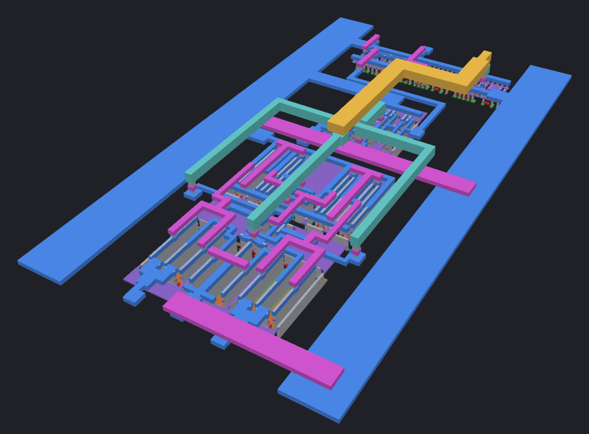
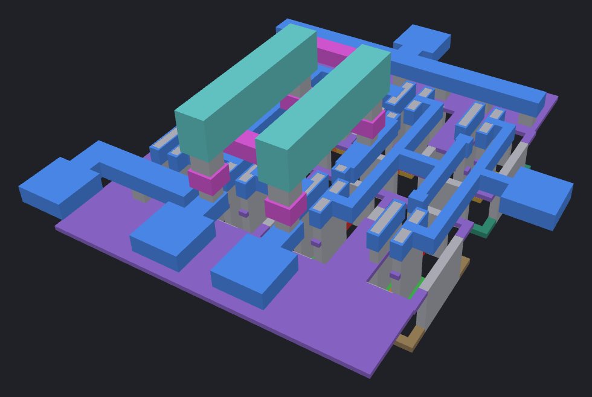
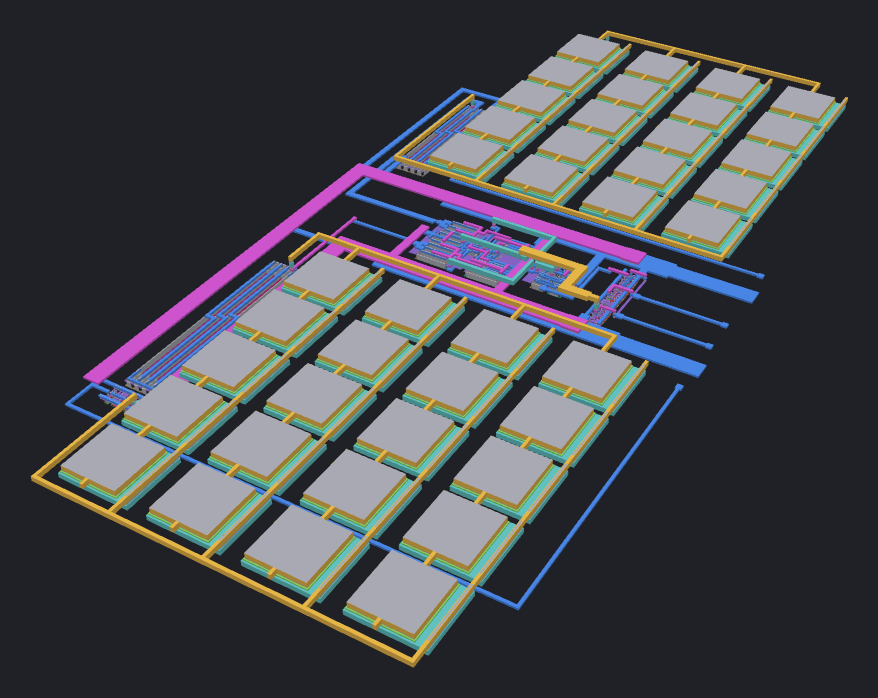
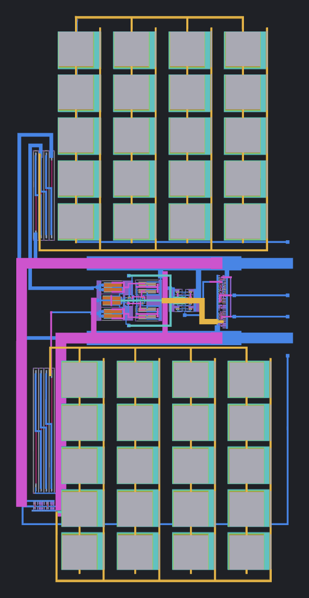

# Analog designs: high speed comparator and 1bit_am

This document describes the two sky130 analog blocks in this repository that are
laid out, routed and LVS checked with the magma flow:

| Design | Layout | Schematic | Size |
|---|---|---|---|
| High speed clocked comparator | `high_speed_comp/high_speed_comp_top_routed.mag` | `xschem/flash_converter/high_speed_comp_top.sch` | 25.0 × 43.5 µm |
| 1bit_am front end | `1bit_am/1bit_am_routed.mag` | `xschem/1bit_am/1bit_am.sch` | 77.8 × 157.5 µm |

All screenshots come from the magma 3D viewer (`mag_viewer3d.py`). See
[Regenerating the screenshots](#regenerating-the-screenshots).

---

## 1. High speed clocked comparator (`high_speed_comp_top`)

### Ports

| Pin | Direction | Function |
|---|---|---|
| `VINP`, `VINN` | in | Differential inputs |
| `CLK` | in | Sampling clock |
| `COMP_OUT` | out | Registered decision (1 = `VINP` > `VINN`) |
| `VDD`, `VSS` | supply | 1.8 V / 0 V |

### Architecture

```
            CLK ──► clkinv_4 ──► CLK' 
                                  │
 VINP ─┐                 ┌────────▼────────┐  VLAT+  ┌───────────────┐        ┌───────────┐
       ├────────────────►│ strong_arm_latch│────────►│ post_amplifier│──VOUT─►│ dfxtp_2   │──► COMP_OUT
 VINN ─┘                 └─────────────────┘  VLAT-  └───────────────┘        │ (CLK)     │
                                                                               └───────────┘
```

The comparator has three stages:

1. **StrongARM latch** (`strong_arm_latch`). Its clock is an inverted copy of `CLK`
   (`sky130_fd_sc_hd__clkinv_4`).
   - Input pair M1/M2 is `nfet_01v8_lvt`, W = 5 µm, L = 1 µm. The long channel lowers offset.
   - Tail switch M3 is also `nfet_01v8_lvt`, 5/1 µm.
   - The cross-coupled regenerative pairs M4–M7 are minimum length (1/0.15 µm).
   - Four 10/0.15 µm PMOS reset switches (M8–M11) precharge the outputs and the internal nodes to VDD.
2. **Post amplifier** (`post_amplifier`). This is a differential stage on the latch outputs
   (M1–M6) with an inverter output (M7/M8). It turns the two latch outputs into one
   full-swing digital signal. It also isolates the latch from the flip-flop load.
3. **Output register** (`sky130_fd_sc_hd__dfxtp_2`). It captures `VOUT` on the rising edge of `CLK`,
   so `COMP_OUT` stays valid for a full clock cycle.

The cell also includes two `decap_3` and three `tapvpwrvgnd_1` standard cells.

### Layout



*Isometric view of `high_speed_comp_top_routed`. The wide metal1 rails on either
side are VDD and VSS. The StrongARM latch is at the near end (bottom of the image)
and the post amplifier is in the middle. The standard cells (DFF, clock inverter,
decaps, taps) are in the row at the far end.*


*Top-down view. `VINP`/`VINN` enter at the bottom. `CLK`, `COMP_OUT` and the
supplies leave at the top. The routing is symmetric about the vertical centre
line, so both latch outputs see matched clock and ground coupling. This was
changed in commit 618ad1f.*

#### Sub-cells

| StrongARM latch (15.0 × 19.8 µm) | Post amplifier (8.6 × 8.9 µm) |
|---|---|
|  |  |

The latch is laid out as a mirrored pair. The large input devices and the tail are at
the near edge, with the PMOS reset and regeneration devices behind them. Dummy
devices were added at the ends of the device rows (commit 13b5dda).

### Verification

- **LVS**: `high_speed_comp/run_lvs.sh`. Netgen reports *Circuits match uniquely*
  (`high_speed_comp/comp.out`). Netgen still reports property
  errors on `strong_arm_latch_routed`.
- **PEX**: `high_speed_comp/run_pex.sh` generates `high_speed_comp_top_routed.pex.spice`.
  `high_speed_comp/net_resistance.py` reports the per-net resistance.

### Post-layout Monte Carlo results (`design001_pex_layout`)

Each corner runs 100 transient simulations on the extracted netlist:

- Clock: 50 MHz.
- Differential input: steps from −100 mV to +100 mV.
- Randomised per run:
  - VDD = N(1.8 V, 50 mV)
  - common mode = N(0.9 V, 0.33 V)
  - temperature = N(40 °C, 30 °C)

`make` runs the simulations and `extract_results.py` summarises them.

| Corner | Working common-mode range | Avg power | Avg / worst prop. delay |
|---|---|---|---|
| tt | 0.46 – 1.7 V | 89 µW | 2.9 ns / 24.9 ns |
| ss | 0.51 – 1.7 V | 79 µW | 2.6 ns / 15.4 ns |
| fs | 0.51 – 1.7 V | 86 µW | 2.9 ns / 15.4 ns |
| sf | 0.44 – 1.7 V | 79 µW | 2.4 ns / 15.4 ns |
| ff | 0.44 – 1.7 V | 71 µW | 2.8 ns / 15.4 ns |

In every corner, all runs passed across −54 to 94 °C and VDD from 1.7 to 1.9 V. The
lower limit of the common-mode range comes from the NMOS input pair. Every failure has
a common mode below about 0.45–0.5 V.

Related experiments:
- `design001_pex_layout_offset*` adds input offset.
- `design001_pex_layout_sin` uses a 100 MHz sine input.

---

## 2. 1bit_am front end (`1bit_am`)

### Ports

| Pin | Direction | Function |
|---|---|---|
| `VIN` | in | Analog input (AC coupled) |
| `CLK` | in | Comparator clock |
| `PWM_IN` | in | 1-bit feedback bitstream |
| `VOUT` | out | Comparator decision |
| `VDD`, `VSS` | supply | 1.8 V / 0 V |

### Architecture

```
                 VDD
                  │
                 R3
                  │
                 R4            ┌──────────────────────┐
 VIN ──┤├────────┼──NET_IN───►│ VINP                 │
       C1        R5            │  high_speed_comp_top │──► VOUT
                  │      ┌───►│ VINN                 │
                 R6      │     └──────────▲───────────┘
                  │      │                │ CLK
                 VSS     │
                         NET_PWM ──┤├── VSS
                         │          C2
 PWM_IN ─► inv ─► inv ─► R1 ─ R7 ─ R8 ─ R2
```

The block reuses the routed comparator from section 1 as a 1-bit quantiser in a
delta-modulator style loop:

- **Input path**: MIM capacitor C1 AC-couples `VIN` onto `NET_IN`. The divider
  R3–R6 (four equal `res_xhigh_po_0p35`, L = 20 µm) biases `NET_IN` at about VDD/2.
- **Feedback path**: The two `inv_1` cells buffer the `PWM_IN` bitstream. It then
  drives an RC low-pass: R1, R7, R8 and R2 in series (`res_xhigh_po_0p35`,
  L = 30 µm each) into C2. The result, `NET_PWM`, is the comparator's reference input.
- **Capacitors**: C1 and C2 are each `cap_mim_m3_1`, W = L = 10 µm, m = 20.
- **Loop**: The comparator compares the input with the filtered feedback. When
  `VOUT` is fed back to `PWM_IN`, the filtered bitstream tracks the input, so the
  bitstream encodes the input signal. In the testbench the loop is closed off-chip
  through two `dfxtp_1` flip-flops.

### Layout



*Isometric view of `1bit_am_routed`. The two 4 × 5 MIM capacitor arrays take up
most of the area. C1 (input coupling) is the far array and C2 (feedback filter)
is the near one. The routed comparator from section 1 sits between them, rotated 90°.*



*Top-down view. C1 is at the top and C2 at the bottom. The comparator is in the
centre. The bias divider R3–R6 is at the top left and the feedback resistors
R1/R7/R8/R2 are at the bottom left. The two feedback inverters are at the bottom
left corner. All six ports are on metal1 at the right-hand edge.*

### Verification

- **LVS**: `1bit_am/run_lvs.sh`. The layout is now LVS clean
  (`1bit_am/comp.out`: *Circuits match uniquely*). Property errors remain on
  `x1bit_am_routed`. `1bit_am/Claude-lvs.md` records the earlier mismatches
  (inverter output shorted to VSS, among others) and how they were fixed.
- **PEX**: `1bit_am/run_pex.sh` generates `1bit_am_routed.pex.spice`.

### Post-layout Monte Carlo (`1bitam_pex_layout`)

`testbench.spice` runs 100 transient runs, each 5 µs long:

- Clock: 250 MHz.
- `VIN`: a 20 mV sine, frequency N(100 MHz, 5 MHz), plus 1 mV transient noise.
- VDD and temperature are randomised as for the comparator.

`extract_results.py` skips the first 3 µs. It then takes an FFT of `VOUT` and `VIN`. A
run passes if the largest spectral peak of `VOUT` is in the same bin as the input tone.

> **Note:** `1bitam_pex_layout/results/results.txt` is currently identical to
> `design001_pex_layout/results/results.txt`. It is in the old comparator format,
> not the format the new `extract_results.py` prints, so it does not hold 1bit_am
> results yet. Re-run `make` in `1bitam_pex_layout` to produce them.

---

## Regenerating the screenshots

The images in `doc/images/` were rendered offscreen with the 3D viewer. Build the
magma extensions (`python3 setup.py build_ext`) and install `requirements.txt`
plus Pillow. Then run:

```sh
PDK_ROOT=/path/to/pdk QT_QPA_PLATFORM=offscreen python3 doc/render_screenshots.py
```

`PDK_ROOT` must contain `sky130A/libs.ref/sky130_fd_sc_hd/mag`, so that the
standard cells render. Without it they appear as empty wireframe boxes.

For interactive viewing:

```sh
PDK_ROOT=/path/to/pdk python3 mag_viewer3d.py 1bit_am/1bit_am_routed.mag
```

Viewer controls:
- Left drag: orbit
- Middle or right drag: pan
- Wheel: zoom
- `F`: frame the selection
- `T`: top-down view
- `R`: reset view

Colours follow `src/LayerStack.py`:
- Blue: metal1
- Magenta: metal2
- Teal: metal3
- Gold: metal4
- Purple: local interconnect
- Red: poly
- Maroon: xhigh_po resistor bodies
- Orange: transistor channels
- Green: MIM capacitor
- Light grey: contacts and vias (including the large MIM top-plate contacts)
