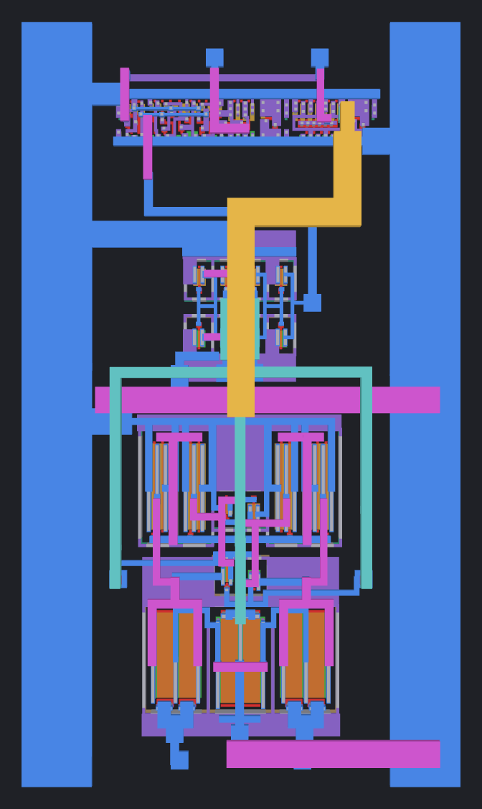
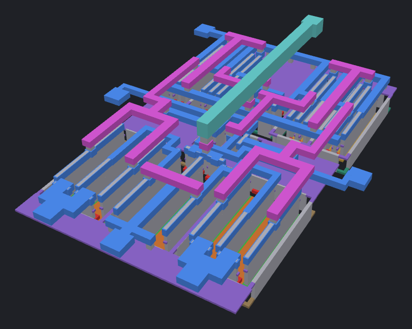
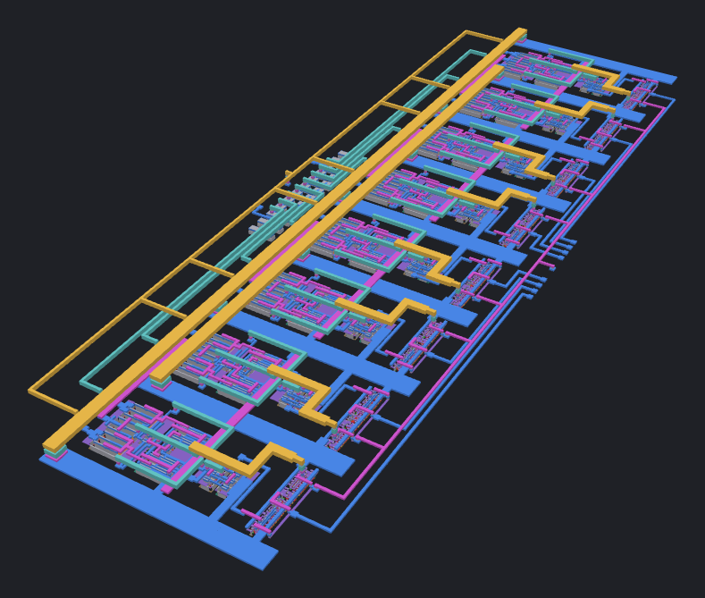
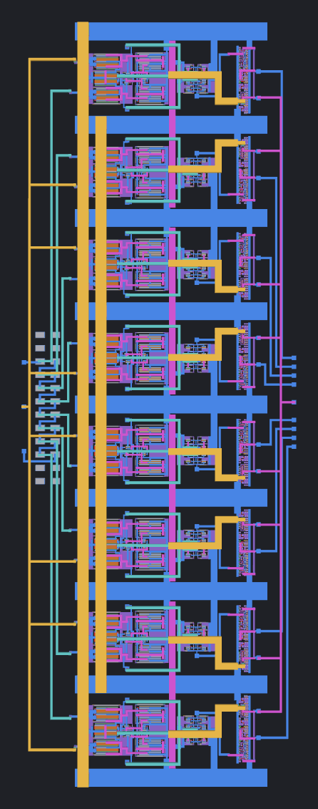
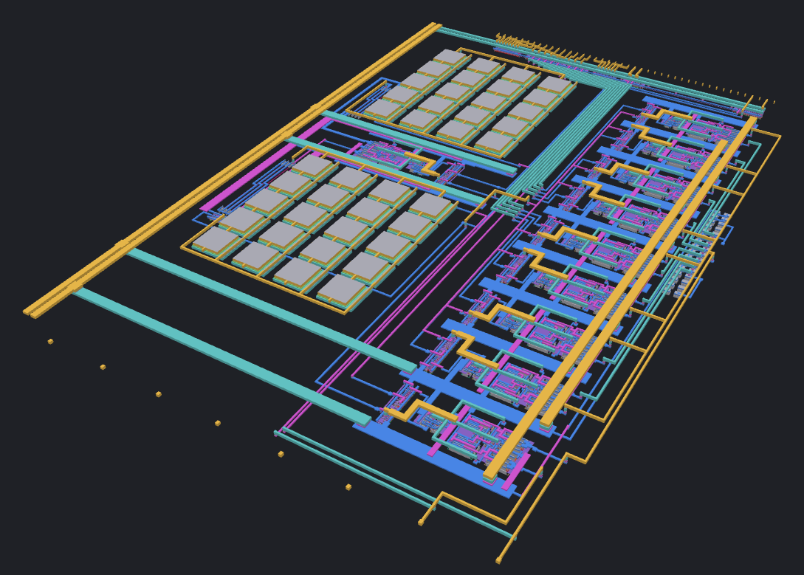
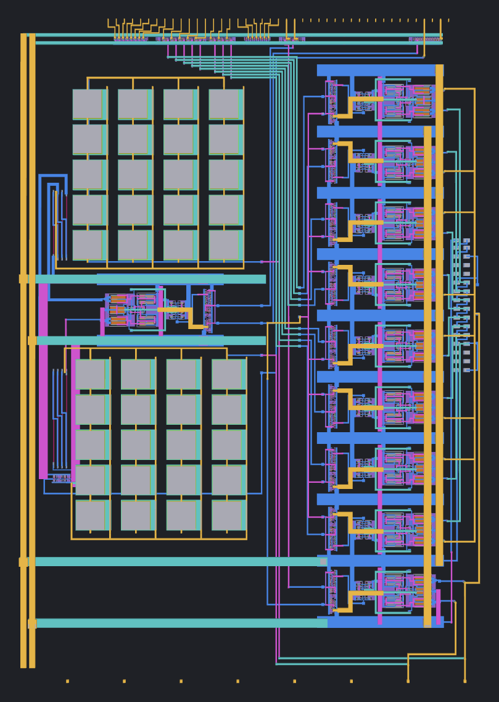

# Analog designs: high speed comparator, 1bit_am and 3-bit flash converter

This document describes the sky130 analog blocks in this repository that are
laid out, routed and LVS checked with the magma flow, and the Tiny Tapeout
top level (`tt/`) that combines them:

| Design | Layout | Schematic | Size |
|---|---|---|---|
| High speed clocked comparator | `high_speed_comp/high_speed_comp_top_routed.mag` | `xschem/flash_converter/high_speed_comp_top.sch` | 25.0 × 43.5 µm |
| 1bit_am front end | `1bit_am/1bit_am_routed.mag` | `xschem/1bit_am/1bit_am.sch` | 77.8 × 157.5 µm |
| 3-bit flash converter | `3bit-flash-converter/flash_converter_routed.mag` | `xschem/flash_converter/flash_converter.sch` | 62.0 × 172.0 µm |
| Tiny Tapeout top level | `tt/tt_um_jamesrosssharp_high_speed_comp.mag` | `xschem/tt/tt_um_jamesrosssharp_high_speed_comp.sch` | 161.0 × 225.76 µm (analog 1x2 tile) |

All screenshots come from the magma 3D viewer (`mag_viewer3d.py`). See
[Regenerating the screenshots](#regenerating-the-screenshots).

---

## 1. High speed clocked comparator (`high_speed_comp_top`)

### Ports

| Pin | Direction | Function |
|---|---|---|
| `VINP`, `VINN` | in | Differential inputs |
| `CLK` | in | Sampling clock |
| `COMP_OUT` | out | Registered decision (1 = `VINP` > `VINN`) |
| `VDD`, `VSS` | supply | 1.8 V / 0 V |

### Architecture

```
            CLK ──► clkinv_4 ──► CLK' 
                                  │
 VINP ─┐                 ┌────────▼────────┐  VLAT+  ┌───────────────┐        ┌───────────┐
       ├────────────────►│ strong_arm_latch│────────►│ post_amplifier│──VOUT─►│ dfxtp_2   │──► COMP_OUT
 VINN ─┘                 └─────────────────┘  VLAT-  └───────────────┘        │ (CLK)     │
                                                                               └───────────┘
```

The comparator has three stages:

1. **StrongARM latch** (`strong_arm_latch`). Its clock is an inverted copy of `CLK`
   (`sky130_fd_sc_hd__clkinv_4`).
   - Input pair M1/M2 is `nfet_01v8_lvt`, W = 5 µm, L = 1 µm. The long channel lowers offset.
   - Tail switch M3 is also `nfet_01v8_lvt`, 5/1 µm.
   - The cross-coupled regenerative pairs M4–M7 are minimum length (1/0.15 µm).
   - Four 10/0.15 µm PMOS reset switches (M8–M11) precharge the outputs and the internal nodes to VDD.
2. **Post amplifier** (`post_amplifier`). This is a differential stage on the latch outputs
   (M1–M6) with an inverter output (M7/M8). It turns the two latch outputs into one
   full-swing digital signal. It also isolates the latch from the flip-flop load.
3. **Output register** (`sky130_fd_sc_hd__dfxtp_2`). It captures `VOUT` on the rising edge of `CLK`,
   so `COMP_OUT` stays valid for a full clock cycle.

The cell also includes two `decap_3` and three `tapvpwrvgnd_1` standard cells.

### Layout


*Isometric view of `high_speed_comp_top_routed`. The wide metal1 rails on either
side are VDD and VSS. The StrongARM latch is at the near end (bottom of the image)
and the post amplifier is in the middle. The standard cells (DFF, clock inverter,
decaps, taps) are in the row at the far end.*



*Top-down view. `VINP`/`VINN` enter at the bottom. `CLK`, `COMP_OUT` and the
supplies leave at the top. The routing is symmetric about the vertical centre
line, so both latch outputs see matched clock and ground coupling. This was
changed in commit 618ad1f.*

#### Sub-cells

| StrongARM latch (15.0 × 19.8 µm) | Post amplifier (8.6 × 8.9 µm) |
|---|---|
|  |  |

The latch is laid out as a mirrored pair. The large input devices and the tail are at
the near edge, with the PMOS reset and regeneration devices behind them. Dummy
devices were added at the ends of the device rows (commit 13b5dda).

### Verification

- **LVS**: `high_speed_comp/run_lvs.sh`. Netgen reports *Circuits match uniquely*
  (`high_speed_comp/comp.out`). Netgen still reports property
  errors on `strong_arm_latch_routed`.
- **PEX**: `high_speed_comp/run_pex.sh` generates `high_speed_comp_top_routed.pex.spice`.
  `high_speed_comp/net_resistance.py` reports the per-net resistance.

### Post-layout Monte Carlo results (`design001_pex_layout`)

Each corner runs 100 transient simulations on the extracted netlist:

- Clock: 50 MHz.
- Differential input: steps from −100 mV to +100 mV.
- Randomised per run:
  - VDD = N(1.8 V, 50 mV)
  - common mode = N(0.9 V, 0.33 V)
  - temperature = N(40 °C, 30 °C)

`make` runs the simulations and `extract_results.py` summarises them.

| Corner | Working common-mode range | Avg power | Avg / worst prop. delay |
|---|---|---|---|
| tt | 0.46 – 1.7 V | 89 µW | 2.9 ns / 24.9 ns |
| ss | 0.51 – 1.7 V | 79 µW | 2.6 ns / 15.4 ns |
| fs | 0.51 – 1.7 V | 86 µW | 2.9 ns / 15.4 ns |
| sf | 0.44 – 1.7 V | 79 µW | 2.4 ns / 15.4 ns |
| ff | 0.44 – 1.7 V | 71 µW | 2.8 ns / 15.4 ns |

In every corner, all runs passed across −54 to 94 °C and VDD from 1.7 to 1.9 V. The
lower limit of the common-mode range comes from the NMOS input pair. Every failure has
a common mode below about 0.45–0.5 V.

Related experiments:
- `design001_pex_layout_offset*` adds input offset.
- `design001_pex_layout_sin` uses a 100 MHz sine input.

---

## 2. 1bit_am front end (`1bit_am`)

### Ports

| Pin | Direction | Function |
|---|---|---|
| `VIN` | in | Analog input (AC coupled) |
| `CLK` | in | Comparator clock |
| `PWM_IN` | in | 1-bit feedback bitstream |
| `VOUT` | out | Comparator decision |
| `VIN_MINUS` | analog | Feedback filter node: comparator `VINN`, top of C2 |
| `VDD`, `VSS` | supply | 1.8 V / 0 V |

### Architecture

```
                 VDD
                  │
                 R3
                  │
                 R4                     ┌──────────────────────┐
 VIN ──┤├─────────┼────────NET_IN──────►│ VINP                 │
       C1        R5                     │  high_speed_comp_top │──► VOUT
                  │                 ┌──►│ VINN                 │
                 R6                 │   └──────────▲───────────┘
                  │                 │              │ CLK
                 VSS                ├──► VIN_MINUS (port)
                                    │
                                    ├──┤├── VSS
                                    │   C2
 PWM_IN ─► inv ─► inv ─► R1─R7─R8─R2┘
```

The block reuses the routed comparator from section 1 as a 1-bit quantiser in a
delta-modulator style loop:

- **Input path**: MIM capacitor C1 AC-couples `VIN` onto `NET_IN`. The divider
  R3–R6 (four equal `res_xhigh_po_0p35`, L = 20 µm) biases `NET_IN` at about VDD/2.
- **Feedback path**: The two `inv_1` cells buffer the `PWM_IN` bitstream. It then
  drives an RC low-pass: R1, R7, R8 and R2 in series (`res_xhigh_po_0p35`,
  L = 30 µm each) into C2. The filtered node, `VIN_MINUS`, is the comparator's reference
  input (`VINN`). It is also a port, so the filter output can be observed. Alternatively,
  the reference can be driven externally (the Tiny Tapeout top level brings it out on `ua[1]`).
- **Capacitors**: C1 and C2 are each `cap_mim_m3_1`, W = L = 10 µm, m = 20.
- **Loop**: The comparator compares the input with the filtered feedback. When
  `VOUT` is fed back to `PWM_IN`, the filtered bitstream tracks the input, so the
  bitstream encodes the input signal. In the testbench the loop is closed off-chip
  through two `dfxtp_1` flip-flops.

### Layout


*Isometric view of `1bit_am_routed`. The two 4 × 5 MIM capacitor arrays take up
most of the area. C1 (input coupling) is the far array and C2 (feedback filter)
is the near one. The routed comparator from section 1 sits between them, rotated 90°.*


*Top-down view. C1 is at the top and C2 at the bottom. The comparator is in the
centre. The bias divider R3–R6 is at the top left and the feedback resistors
R1/R7/R8/R2 are at the bottom left. The two feedback inverters are at the bottom
left corner. All seven ports are on metal1 at the right-hand edge. From top to bottom
they are `VIN`, `VDD`, `VOUT`, `CLK`, `VSS`, `VIN_MINUS` and `PWM_IN`.*

### Verification

- **LVS**: `1bit_am/run_lvs.sh`. The layout is now LVS clean
  (`1bit_am/comp.out`: *Circuits match uniquely*). Property errors remain on
  `x1bit_am_routed`. These are the same latch `nfet_01v8_lvt` `w` = 10 vs 5 errors as
  in section 1. `1bit_am/Claude-lvs.md` records the earlier mismatches
  (inverter output shorted to VSS, among others) and how they were fixed.
- **PEX**: `1bit_am/run_pex.sh` generates `1bit_am_routed.pex.spice`.

### Post-layout Monte Carlo (`1bitam_pex_layout`)

`testbench.spice` runs 100 transient runs, each 5 µs long:

- Clock: 250 MHz.
- `VIN`: a 20 mV sine, frequency N(100 MHz, 5 MHz), plus 1 mV transient noise.
- VDD and temperature are randomised as for the comparator.

`extract_results.py` skips the first 3 µs. It then takes an FFT of `VOUT` and `VIN`. A
run passes if the largest spectral peak of `VOUT` is in the same bin as the input tone.

> **Note:** `1bitam_pex_layout/results/results.txt` is currently identical to
> `design001_pex_layout/results/results.txt`. It is in the old comparator format,
> not the format the new `extract_results.py` prints, so it does not hold 1bit_am
> results yet. Re-run `make` in `1bitam_pex_layout` to produce them.

---

## 3. 3-bit flash converter (`flash_converter`)

### Ports

| Pin | Direction | Function |
|---|---|---|
| `VIN` | in | Analog input, shared by all eight comparators |
| `CLK` | in | Sampling clock, shared by all eight comparators |
| `RES_TOP`, `RES_OUT` | analog | Top and bottom of the internal reference ladder |
| `O0`..`O7` | out | Comparator decisions (thermometer code, `O0` = highest threshold) |
| `VDD`, `VSS` | supply | 1.8 V / 0 V |

### Architecture

```
 RES_TOP ──┬──────────────► VINN ┐
           R1                    x1 (VINP = VIN) ──► O0
           ├──────────────► VINN ┐
           R2                    x2 ──► O1
           ├──────────────► VINN ┐
           ⋮                     ⋮
           R7
           ├──────────────► VINN ┐
           R8                    x8 ──► O7
 RES_OUT ──┘
```

- **Comparators**: eight `high_speed_comp_top` instances (the routed comparator from
  section 1) share `VIN` on `VINP`, and `CLK`.
- **Ladder**: comparator `xk` takes its `VINN` from tap k−1 of a ladder of eight equal
  `res_high_po_1p41` resistors (R1–R8, L = 1.41 µm) between `RES_TOP` and `RES_OUT`.
  `x1` sees `RES_TOP` itself.
- **Thresholds**: these are set by what is connected to `RES_TOP` and `RES_OUT`.
  Because the ladder ends are ports, the parent cell can add resistors to place the
  thresholds within the comparator's working common-mode range (0.46–1.7 V,
  section 1). In the Tiny Tapeout top level, one resistor above and three below give
  thresholds of 1.65 V down to 0.60 V. See [section 4](#4-tiny-tapeout-top-level-tt).
- **Outputs**: these form a thermometer code. Each output is registered by its own
  comparator's flip-flop, so all eight outputs update on the same `CLK` edge.
- **Dummies**: R9–R12 are unconnected dummy resistors at the ends of the ladder.
- **Unwired encoder**: `xschem/flash_converter/flash_converter_digital.sch` holds
  `xor2_2` and `inv_1` cells for a thermometer-to-binary encoder, but it has no wires
  yet. It is not used in the layout or in the Tiny Tapeout top level.

`xschem/flash_converter/flash_converter_test.sch` is a schematic-level transient
testbench with these settings:

- Clock: 50 MHz.
- `VIN`: 1.1 V ± 0.7 V sine at 1 MHz.
- Ladder ends: 500 Ω from VDD to `RES_TOP` and 1.5 kΩ from `RES_OUT` to ground.

There is no post-layout simulation of the converter yet.

### Layout



*Isometric view of `flash_converter_routed`. The eight comparators are stacked in a
single column, each rotated 90°, with alternate comparators mirrored. The wide
horizontal metal1 bars are the supply rails.*



*Top-down view. `x1` (`O0`) is at the top and `x8` (`O7`) at the bottom.*

- **Ladder**: R1–R8 are the column of small resistors at the left of the cell. R9/R10 are
  dummies above it and R11/R12 dummies below it.
- **Ports**:
  - `VIN`, `RES_TOP` and `RES_OUT` are on metal1 at the left-hand edge.
  - `O0`–`O7` and `CLK` are on metal1 at the right-hand edge.
  - `VDD` and `VSS` are near the top right.
- **Power**: two 2.5 µm metal4 stripes run the height of the cell, VDD (longer) and VSS.
  A via stack drops them onto the metal1 rails every 42 µm.
- **Signal routing**:
  - `VIN` fans out to every `VINP` on metal4, and the ladder taps reach `VINN` on metal3.
  - `CLK` and the outputs route on metal1/metal2 down the right-hand side.

### Flow

- **Route.** `route_flash_converter.py`, run from the repository root, reads the
  hand-placed `3bit-flash-converter/flash_converter.mag` and writes
  `flash_converter_routed.mag`.
- **Check LVS.** Run `3bit-flash-converter/run_lvs.sh [PDK_ROOT]`. It compares against
  `flash_converter_routed.xschem.out.spice`.
- **Local and linked cells.** The ladder resistor cells (`sky130_fd_pr__res_high_po_1p41_*.mag`)
  are local to the directory. The comparator sub-cells are symlinks into `high_speed_comp/`,
  `post-amp/` and `strong-arm/`.

### Verification

- **LVS**: `3bit-flash-converter/comp.out` reports *Circuits match uniquely*. Both sides
  have 178 devices and 111 nets after merging. This has been the case since commit 6557fce.
  - Property errors remain on 24 devices, `w` = 10 vs 5. These are the latch's `nfet_01v8_lvt`
    input pair and tail (M1–M3) in each of the eight comparators.
  - The latch layout draws each of these transistors as two 5 µm fingers in parallel,
    for a total W of 10 µm. The schematic has W = 5 µm, nf = 1.
  - This is the same discrepancy behind the property errors in sections 1, 2 and 4.
    Either the schematic should become W = 10 µm, nf = 2, or the layout should
    become single 5 µm devices.
- **DRC**: the routed cell was reported DRC clean when it was first routed (commit 8997841).
  No later DRC result is recorded, and there is no DRC script in the directory.

---

## 4. Tiny Tapeout top level (`tt/`)

`tt_um_jamesrosssharp_high_speed_comp` is the submission for a Tiny Tapeout analog
**1x2 tile** (161.0 × 225.76 µm). It places three blocks in the tile:

- the 1bit_am front end from section 2;
- one standalone copy of the comparator from section 1;
- the 3-bit flash converter from section 3.

It then wires them to the Tiny Tapeout pins.

### Pin usage

| TT pin | Connection |
|---|---|
| `ua[0]` | Shared analog input: 1bit_am `VIN`, standalone comparator `VINP`, flash converter `VIN` |
| `ua[1]` | 1bit_am `VIN_MINUS` (feedback filter node) and standalone comparator `VINN` |
| `clk` | `clkbuf_16` → `clk_prime`, which clocks all 10 comparators (1bit_am, standalone, 8 × flash) |
| `ui_in[0]` | 1bit_am `PWM_IN` (1-bit feedback bitstream) |
| `uo_out[0]` | 1bit_am `VOUT`, through a `buf_4` |
| `uo_out[1]` | Standalone comparator `COMP_OUT`, through a `buf_4` |
| `uio_out[0..7]` | Flash converter outputs `O0..O7`, each through a `buf_4` |
| `uio_oe[0..7]` | Tied high (`conb_1` HI), so every `uio` pin is an output |
| `uo_out[2..7]` | Tied low (`conb_1` LO) |
| `VDPWR`, `VGND` | 2 µm metal4 power stripes at x = 1 µm and 4 µm |
| `ena`, `rst_n`, `ui_in[1..7]`, `uio_in[*]`, `ua[2..7]` | Unused |

### Flash converter thresholds

The flash converter from section 3 is instance `x2`, rotated 180°. At the top level,
its reference ladder is extended with more `res_high_po_1p41` resistors of the same
size. The full ladder runs as follows: VDPWR → XR11 → `RES_TOP` → the converter's
R1–R8 → `RES_OUT` → XR1–XR3 → VGND.

That makes 12 equal resistors in total. Comparator `Ok` therefore trips when
`ua[0]` > (11 − k)/12 · VDD:

| Output | O0 | O1 | O2 | O3 | O4 | O5 | O6 | O7 |
|---|---|---|---|---|---|---|---|---|
| Threshold at VDD = 1.8 V | 1.65 V | 1.50 V | 1.35 V | 1.20 V | 1.05 V | 0.90 V | 0.75 V | 0.60 V |

The outputs form a thermometer code. Steps are 150 mV and every threshold sits inside
the comparator's working common-mode range.

### Layout



*Isometric view of `tt_um_jamesrosssharp_high_speed_comp`. The 1bit_am block, with
its two MIM capacitor arrays, is on the left. The column of nine comparators is on
the right.*



*Top-down view.*

- **Pins**: The digital pins (`clk`, `ui_in`, `uo_out`, `uio_*`) are along the top edge.
  The analog pins `ua[0..7]` are along the bottom edge.
- **Power**: The `VDPWR`/`VGND` metal4 stripes run down the left edge. The wide
  horizontal metal3 straps carry power across to the blocks.
- **Standard-cell row**: This row is under the top edge. It holds the tie cells,
  output buffers, `clkbuf_16`, decaps and taps.
- **Comparators**: The right-hand column holds the eight flash-converter
  comparators. The standalone comparator (`x11`) is at the bottom of that column.

### Flow

| File | Purpose |
|---|---|
| `tt_analog_1x2.def`, `magic_init_project.tcl` | Tiny Tapeout template. These give the pin positions and draw the power stripes. |
| `tt_um_jamesrosssharp_high_speed_comp_master.mag` | Hand placement of the instances, with no top-level routing |
| `../route_tt.py` | magma router script. It reads the master cell and writes the routed `tt_um_jamesrosssharp_high_speed_comp.mag`. |
| `run_lvs.sh` | Runs magic extraction to produce `*.lvs.out.spice`. It then runs netgen against `*.xschem.out.spice` and writes the result to `comp.out`. |
| `make_gds_lef.sh` | Writes `gds/` and `lef/` from the routed cell |
| `*.mag` symlinks | Point at the sub-cell layouts in `1bit_am/`, `high_speed_comp/` and `3bit-flash-converter/`, so magic can find them |

The rebuild steps are:

1. **Route.** Run `python3 route_tt.py` from the repository root. It needs the built magma
   extensions in `build/` and the PDK in `~/.ciel/sky130A`.
2. **Check LVS.** Run `cd tt && ./run_lvs.sh [PDK_ROOT]`. `PDK_ROOT` defaults to `/opt/pdk/`.
3. **Export.** Run `cd tt && ./make_gds_lef.sh [PDK_ROOT]`.

`*.xschem.out.spice` is the netlist of `xschem/tt/tt_um_jamesrosssharp_high_speed_comp.sch`,
exported from xschem. Re-export it whenever the schematic changes.
`tt_um_jamesrosssharp_high_speed_comp.spice` is an older export that LVS does not use. It still
has `buf_16` output buffers where the design now uses `buf_4`.

`gds/` and `lef/` also contain `tt_um_analog_example.*`, the original
Tiny Tapeout template example.

### Verification

- **LVS**: `tt/comp.out` reports *Circuits match uniquely*. Both sides have 253 devices
  and 178 nets after merging. Netgen lists 24 property errors, all `w` = 10 vs 5 on
  the latch's `nfet_01v8_lvt` devices. This is the same two-finger layout vs
  single-finger schematic discrepancy described in section 3.
- **Routing short fixed in commit d816b13**: The metal3 via landing pads on the `conb_1`
  LO pins for `uo_out[2..7]` overlapped the horizontal VDPWR metal3 strap. This shorted
  all six outputs to VDPWR and caused *Top level cell failed pin matching*. The via
  stack now lands lower, clear of the strap.
- **DRC**: There is no DRC script in `tt/` yet. Run Tiny Tapeout's precheck before
  submitting.

---

## Regenerating the screenshots

The images in `doc/images/` were rendered offscreen with the 3D viewer. Build the
magma extensions (`python3 setup.py build_ext`) and install `requirements.txt`
plus Pillow. Then run:

```sh
PDK_ROOT=/path/to/pdk QT_QPA_PLATFORM=offscreen python3 doc/render_screenshots.py
```

To render only some of the shots, pass their output names, for example
`... render_screenshots.py tt_top_iso.png tt_top_top.png`.

`PDK_ROOT` must contain `sky130A/libs.ref/sky130_fd_sc_hd/mag`, so that the
standard cells render. Without it they appear as empty wireframe boxes.

For interactive viewing:

```sh
PDK_ROOT=/path/to/pdk python3 mag_viewer3d.py 1bit_am/1bit_am_routed.mag
```

Viewer controls:
- Left drag: orbit
- Middle or right drag: pan
- Wheel: zoom
- `F`: frame the selection
- `T`: top-down view
- `R`: reset view

Colours follow `src/LayerStack.py`:
- Blue: metal1
- Magenta: metal2
- Teal: metal3
- Gold: metal4
- Purple: local interconnect
- Red: poly
- Maroon: xhigh_po resistor bodies
- Orange: transistor channels
- Green: MIM capacitor
- Light grey: contacts and vias (including the large MIM top-plate contacts)
